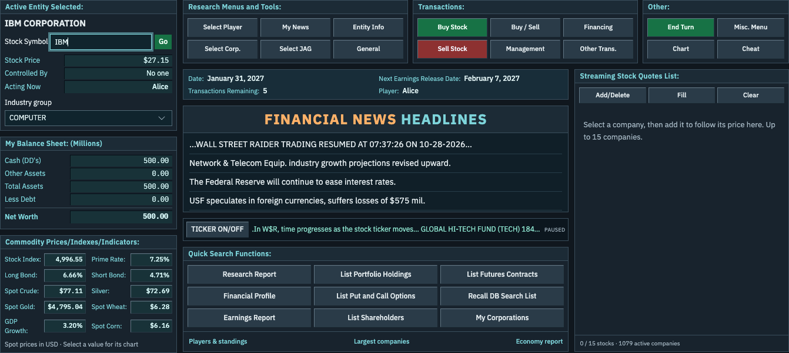

# Wall Street Raider in your browser

An unofficial browser port of Wall Street Raider 9.85, with a Rust game engine
compiled to WebAssembly and a Svelte interface. Import your own `wsr985.exe` to
play; installer extraction and gameplay run locally in your browser.

**[Play on GitHub Pages](https://elohmeier.github.io/wsr/)**



## Play

1. Open the [browser app](https://elohmeier.github.io/wsr/).
2. Choose **Open wsr985.exe** and select the installer from your own copy of
   Wall Street Raider 9.85. The installer is read locally; it is not executed
   or uploaded.
3. Choose **New game**, or use **Open a saved game** to import a `GAME##.DAT` file.

Use a current browser with JavaScript and local storage enabled. On the first
visit, the page may reload once to prepare the game worker.

## Features and compatibility

- Trading in stocks, bonds, options and futures, company management, and AI players.
- Company research, financial reports, market charts and ownership diagrams.
- New games, save imports, browser saves and downloadable backups.
- Searchable help, glossary and strategy manual from your installer.
- An optional [learning coach](web/README.md#learning-coach) that can explain the
  documentation and inspect player-visible game information using your own model
  provider and API key. Selected excerpts and visible state are sent to that
  provider.

The engine ports the original PowerBASIC logic, including its numeric and save-file
conventions. Compatibility tests compare routines and simulation sequences with
the original executable. Complete game parity is still being validated; see the
[engine guide](engine/README.md), [known bugs](engine/BUGS.md) and
[numeric compatibility notes](engine/NUMBERS.md). The browser enables additional
load/save validation and selected repairs for original-game bugs.

## Saves

Imported resources and saves are kept in IndexedDB in the browser you use to play.
They are not synced between browsers, devices or hosting addresses. In **Game &
saved games**, select a save and choose **Download file** to keep a backup or move
it to another browser. Clearing the site's browser data also removes its saves.

## Run locally

Install Node.js, Rust with Cargo and rustup, and Python 3. The
[CI workflow](.github/workflows/ci.yml) uses Node.js 26 and Rust 1.99.0.
From the repository root:

```sh
rustup target add wasm32-unknown-unknown
npm --prefix web ci --ignore-scripts
npm --prefix web run build
python3 web/serve.py 8899
```

Open <http://localhost:8899/> and import your installer as above. The build includes
the WASM engine and web interface; no original game files are needed to build it.
See the [browser guide](web/README.md) for live development and hosting details.

## Development

These checks run without original game files, after installing the web dependencies:

```sh
cargo test --manifest-path engine/Cargo.toml --workspace --locked
npm --prefix web run check
npm --prefix web run test:client
npm --prefix web run test:content
npm --prefix web run test:coach
python3 tools/generate_content_schema.py --check
python3 tools/audit_content.py
```

The [engine guide](engine/README.md#original-engine-comparisons) covers optional
comparisons requiring your own original game files. Pushes to `main` run the public
checks, build the app and deploy it to GitHub Pages; pull requests run the checks.

| Directory | Purpose |
| --- | --- |
| [`engine/wsr-core`](engine/wsr-core) | Game logic, numeric runtime, resources and save format. |
| [`engine/wsr-wasm`](engine/wsr-wasm) | Browser session binding and worker interface. |
| [`web`](web) | Svelte interface, installer reader, storage and learning coach. |
| [`tools`](tools) | Analysis, resource-schema generation and compatibility utilities. |

## License and disclaimer

This is an unofficial fan project for Wall Street Raider. It is not affiliated with
or endorsed by the game's creators, publishers, or rights holders. The game's name,
branding and resources remain the property of their respective owners.

Original game binaries and runtime resource packs are not bundled with this
repository or its web distribution. You must supply your own lawfully obtained
copy of the supported installer. The [MIT License](LICENSE) covers this project's
contributions and grants no rights in the original game or user-imported resources.
See [dependency notices](THIRD-PARTY-NOTICES.md) for third-party licenses.
