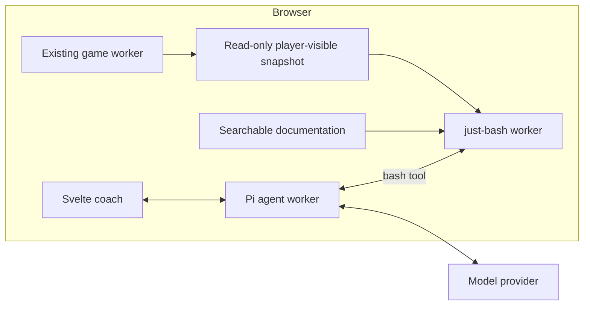

# Browser assistant implementation plan

Status: implemented and covered by automated checks. Updated 2026-10-28.

Add a learning coach to the browser trading desk using Pi and just-bash. The assistant
helps players understand the game, interpret their situation, compare choices and develop
a strategy through conversation. Players make every game decision and perform every action.

The agent loop, documentation search and game inspection run in the browser. The working
assumption is direct model API access using the player's own credentials, with no application
backend. Pi supplies the agent runtime and model interface; fully local model inference
would require an additional adapter and is outside the initial scope.

## Scope

Open the assistant from **Learning coach** in the desk menu. It supports three kinds of conversation:

- **Explain a situation:** explain a selected metric, company or game mechanic.
- **Help me decide:** compare plausible choices using the player's visible game state.
- **Build a strategy:** discuss goals, constraints, a thesis, risks and review criteria.

Answers should connect observations to documented mechanics, explain tradeoffs and suggest
what the player could investigate next. Give direct answers to direct questions, with hints
and worked explanations when useful. Avoid forcing a question-and-answer lesson on every request.

Strategy support stays in the conversation. A strategy notebook, dedicated calculators,
what-if simulation and automated optimization are outside scope. The assistant cannot trade,
answer game dialogs, advance time, change settings, customize companies, or save or load games.

## Runtime architecture

Use `@earendil-works/pi-agent-core` for the agent loop and `@earendil-works/pi-ai` for model
transport, with a Svelte interface matching the existing desk. Consult the installed package
sources and the `earendil-works/pi` repository. Use its browser-compatible packages rather
than the full coding-agent SDK. Pin reviewed package versions for reproducible builds.

Expose one Pi tool, `bash`, backed by `just-bash/browser`. Implement the game CLI as custom
commands in that shell. This gives the agent familiar documentation and data inspection
tools without adding a native shell or server runtime.



Keep the existing engine worker unchanged in responsibility. Add an agent worker and a
separate shell worker so a runaway shell command can be terminated without losing the
conversation. Credentials belong to the model transport and never enter shell files,
environment variables, tool output or model messages.

The app supplies documentation and snapshots to the assistant. Neither assistant worker
receives the engine's action RPC, dialog answer buffer, raw WASM memory or save storage.
Validate the messages accepted by each worker; do not provide a generic engine RPC bridge.

## Read-only game observation

Implement a dedicated `engine/wsr-wasm/src/observer.rs` module. Its output is a structured
view of information available to the current player, independent of the desk summary's
limited company list. Keep current player, active entity and selected company distinct.

Include player finances, holdings, debt and derivatives; public company financials,
ownership, industry information and price history; visible economy and news; and the
game date and remaining transactions. Treat current screen and displayed report/dialog
text as additional context supplied by the app.

Filter information before it crosses into the assistant workers. Exclude unrevealed
events, scenario outcomes, AI plans, RNG state and other human players' private information.
The view must follow game visibility rules, including any research restrictions or costs.
It must not generate restricted research for free.

Existing report APIs are not read-only. `report_json` uses live globals and RNG, and the
research report can rebalance cash, trigger borrowing and change other financial state.
Do not expose these APIs or use an automatic dialog-answering UI to collect reports.

Prefer pure reads from `&Globals`. Where a legacy financial calculation requires mutation,
run an audited calculation on a private clone with a private RNG, following the existing
summary readout pattern. Do not present newly randomized report content as an observation.
Reuse the text of reports the player has actually opened when explaining those reports.

Each snapshot carries a schema version, session identifier, revision, player scope, game
date and capture status. Revisions change when relevant state changes, even within the same
game date; loading or replacing a game creates a new session identity. Values carry explicit
units and currency. Preserve unavailable values as such rather than substituting zero.

Snapshot production must leave live globals, RNG and virtual files unchanged. Repeated
inspection of the same revision must return consistent results.

## Documentation filesystem

Reuse the installer assets and parsing in `docs.mjs`. Normalize Windows-1252 sources to UTF-8,
split help topics by their existing IDs and split the strategy manual into meaningful sections.
Preserve headings, tables, source anchors and image captions where available.

```text
/docs/INDEX.md
/docs/help/<topic-id>.txt
/docs/glossary/<term>.txt
/docs/manual/<section-id>.txt
/docs/tutorials/<lesson-id>.txt
/game/snapshot.json
/tmp/
```

Provide section titles and a small vocabulary alias map in the index. Start with ordinary
text search; a vector database is unnecessary for the initial implementation. Store source
IDs, line ranges, original anchors and content versions so answers can cite the retrieved
passage and open it in the documentation viewer.

The current tutorial menu opens an external URL; the tutorial is not part of the locally
imported help, glossary and manual. Support a locally imported tutorial or app-authored
lessons. Runtime access to the external tutorial site must not be required. Missing documents
should be identified as unavailable, with a clear way for the player to import them.

Documentation and company text are evidence, not executable instructions. Strip active HTML
content during normalization and render model output without executing embedded HTML or code.

## Shell and CLI contract

The `wsr` command reads the frozen snapshot and supplied screen context. It never invokes
live engine actions. Provide discoverable help, validated arguments, stable entity IDs,
useful errors, and JSON output for composition with text tools.

| Proposed command | Purpose |
|---|---|
| `wsr context` | Player, active entity, selection, screen, date and revision |
| `wsr player --json` | Current player's financial position |
| `wsr portfolio --json` | Current player's holdings and visible exposures |
| `wsr company <id> --json` | Public company information |
| `wsr industry <id> --json` | Visible industry information |
| `wsr economy --json` | Current economic indicators |
| `wsr news` | News already available to the player |
| `wsr history <id> --json` | Available historical prices |
| `wsr report current` | Text of the report currently displayed |

Example tool calls:

```bash
grep -Rni "margin" /docs/help /docs/manual
cat /docs/glossary/leverage.txt
wsr portfolio --json | jq '.holdings'
wsr company 131 --json
```

Enforce read-only access to `/docs` and `/game` in the filesystem implementation, including
redirections, path traversal and symlinks. Allow bounded temporary text files in `/tmp`.
The shell has no network access, host filesystem, arbitrary JavaScript execution or
credentials. Custom commands close over only the observation data they need.

Bound execution time, command count, input/output size, filesystem size and total tool use
per question. Execute bash calls sequentially to avoid races over temporary files. Forward
cancellation and terminate/recreate the shell worker if it fails to stop. Return explicit
truncation and error information rather than treating incomplete output as complete evidence.

## Interface and state lifecycle

Offer an optional coach panel on desktop and an accessible compact view on smaller screens,
opened from the desk menu. Keep engine dialogs and messages focused on their existing actions.
If a dialog appears while opening the coach, preserve its entered values and respect modal focus.

Opening the coach suspends background ticker scheduling through the app, like the existing
documentation panel. Resume scheduling only when the relevant panels close and the game's
clock state permits it. The agent itself receives no pause or resume command.

When the engine is idle, capture a fresh observer snapshot after any in-flight command
finishes. The engine uses `Atomics.wait` while a dialog is open, so the assistant must not
depend on a new RPC to that worker during a pending dialog. Use the most recent completed
snapshot and the current dialog text, identifying their separate capture status. If a
question requires unavailable current data, explain that it can be checked after the player
finishes the dialog. Do not answer or close it automatically.

Publish snapshots at safe command boundaries and coalesce background updates rather than
serializing the full state on every ticker tick. Freeze a snapshot for each assistant
question. If the player continues playing, mark previous numerical analysis as outdated and
refresh before using it for a new decision. Do not silently mix revisions in one answer.

Distinguish documented rules, observed facts and strategic hypotheses in responses. Link
mechanical explanations to retrieved sources and associate state claims with their snapshot.
Show a brief activity indicator while reading sources, an optional tool trace, a stop control
and recoverable errors. Avoid unsolicited interruptions during play.

## Svelte controls

Use the existing shadcn-svelte component system. The `huntabyte/shadcn-svelte` repository
includes dedicated chat components,
AI interface composition examples and Nova styles for the required controls.

| Interface need | Components and composition |
|---|---|
| Conversation and streaming scroll | `MessageScroller.Provider`, `Root`, `Viewport`, `Content`, `Item` and `Button`; anchor the player's turn and follow the reply only while the reader stays at the live edge |
| Player and coach messages | `Message` and `Bubble`, with the coach's explanations rendered as readable text and source links |
| Question composer | `InputGroup.Textarea` with a `block-end` addon for Send and Stop buttons; reuse `Field` for a visible label and help text |
| Initial suggestions | Existing `Button` controls inside the coach for explaining a situation, comparing choices and building a strategy |
| Status and stale context | `Marker` for compact thread notices; `Spinner` with a short accessible status while work is pending |
| Sources and optional tool details | `Trace.Collapsible` and `Trace.Line`; source entries open the local documentation viewer and bounded tool output can use a plain `pre` |
| Mobile and contextual explanations | `Sheet` for the compact coach; reuse `Dialog` when opened above an engine dialog, preserving modal focus and entered game values |
| Setup and failures | Existing `Field`, `Input`, `Button`, `Alert` and `Empty` controls |

Use a normal responsive docked panel beside the desk on desktop. A Sheet is a Dialog-based
overlay, so do not assume it supplies a persistent desktop layout. Resizable panels are
optional and would add PaneForge; they are unnecessary for the initial layout. The transcript
already has a scroll viewport and should not be wrapped in a second competing scroll container.

The chat, prompt-input, source-list and tool-trace examples demonstrate composition, not a
required transport. Several demos import `@ai-sdk/svelte`, `ai` and scripted server-style
helpers. Adapt the UI to a small view model driven by Pi message and tool events. Keep Pi as
the only agent runtime, without adding those demo dependencies or a chat API route. The
composer needs text, Send and Stop; attachment controls are outside the initial interface.

The MessageScroller registry wrapper depends on `@shadcn-svelte/primitives/message-scroller`.
Pin and review that additional dependency. Add only the required registry components using
the app's existing Nova style and Phosphor icon configuration. Check generated imports,
utility CSS, primitive versions and peer dependencies against the app's locked dependencies;
the presence of components in the checkout does not establish compatibility with the current
`shadcn-svelte` 1.7.1 installation. Preserve the desk's dark theme, fonts and square controls
when adapting the generated styles.

Use the scroller's labelled keyboard-focusable viewport and log semantics, with `aria-busy`
while a reply streams. Announce useful status changes without reading every token. Preserve
the reader's position when they scroll back and provide a Jump to latest control. Respect
reduced motion. Enter submits and Shift+Enter inserts a newline; IME composition must not
submit. Composer keystrokes must not trigger the underlying game's Enter/Escape handlers.
Closing the coach restores focus without answering or closing any pending engine dialog.

## Model access and conversation scope

Load Pi and the selected provider only when the coach is used. Use explicit provider imports
and a browser-compatible transport. Validate CORS, streaming and cancellation with the app's
existing COOP/COEP headers. Do not assume the player's native Pi login or Node-only OAuth
flows are available to the browser.

Use player-supplied credentials held in memory by default. Do not embed a shared application
key. Explain at setup that questions, retrieved excerpts and selected visible state are sent
to the configured provider. Full saves, raw globals and unrelated installer files must never
enter the model context. Send only the evidence needed for the current question.

Keep conversations in memory initially. Reset the conversation and invalidate pending work
when a game is replaced or the human player changes, preventing private context from carrying
over. Keep diagnostics local and redact credentials. Bound conversation size and model/tool
rounds; unavailable model access must leave ordinary gameplay and documentation usable.

## Implementation stages

The runtime, observer, shell, documentation import and Svelte interface are implemented.
The acceptance checks below also describe the continuing evaluation criteria.

| Stage | Deliverable | Acceptance checks |
|---|---|---|
| 1 | Browser runtime proof using Pi, a faux provider and a separate just-bash worker | Browser build has no required Node runtime; streaming, cancellation and worker restart work; one direct provider works under the app's isolation headers |
| 2 | Observer exports and versioned snapshot types | Query success, failure and repetition preserve globals, RNG and files; visible values and units match the game; private and unrevealed data are excluded |
| 3 | Documentation normalization, source resolution and the `wsr` CLI | Help, glossary, manual and available tutorials can be searched and cited; CLI output matches snapshots; filesystem, network and execution limits hold |
| 4 | Svelte coach using the mapped shadcn controls and Pi-driven view model | Chat components build with the app's dependencies; scroll and keyboard behavior work; dialogs retain inputs and focus; the coach works while the engine is blocked; ticker suspension, stale analysis and game/player changes behave correctly |
| 5 | Tutoring behavior and end-to-end evaluation | Answers explain mechanics and choices with evidence; unsupported claims and missing data are handled explicitly; novice players can justify their decisions |

Use Pi's faux provider for repeatable agent integration tests. Add focused observer tests
that compare complete live state, RNG and virtual files before and after inspection,
including error paths. Check shell writes, traversal, unknown verbs, attempted network
access, excessive output and runaway execution. Test that document instructions cannot
grant additional capabilities.

Extend browser regressions for pending dialogs, preserved option orders, keyboard/mobile
use, snapshot refresh, player changes, missing documents and provider failure. Include the
case where a dialog appears during an in-flight command as the coach opens, so snapshot
acquisition cannot deadlock. Check that streaming preserves a reader's earlier scroll position,
Jump to latest resumes following, IME input cannot accidentally submit, and coach keyboard
events cannot answer the underlying game dialog.

Evaluate explanations with representative questions about borrowing, concentrated holdings,
company research and options. Success means players understand the mechanic, identify a risk
and explain a choice. Winning the simulation or accepting every suggestion is not the goal.

## Implementation and validation

- `engine/wsr-wasm/src/observer.rs` exports `wsr_observe`, with public company data,
  current-player finances and portfolios, and the active controlled company. Dedicated tests
  compare complete live globals, RNG, virtual files and their pending write journal before
  and after repeated inspection, and check player visibility and financial units.
- `src/lib/coach/agent.worker.ts` runs Pi with an explicit browser provider import.
  `session.ts` supplies the tutor prompt, one TypeBox `bash` tool, text-only conversation
  history with snapshot labels, and research/context limits. Each question has a 90-second
  deadline and creates an isolated shell worker.
- `shell.ts` supplies the read-only `wsr` CLI and just-bash commands, including its built-in
  TypeScript `jq`. The tool returns at most 16,000 characters and marks oversized output as
  incomplete. Intermediate pipelines may process up to 2 MB. `/tmp` has a bounded in-memory
  filesystem; neither credentials nor engine capabilities are mounted.
- `docs.ts` builds versioned sections from the owner's imported help, glossary and manual.
  Locally imported HTML tutorials are parsed in an inert template and reduced to text.
  Retrieved source paths resolve to a local viewer with line numbers.
- `Coach.svelte`, `CoachText.svelte` and `CoachSource.svelte` provide the desktop dock,
  mobile Sheet, contextual Dialog, safe answer rendering, citations, tool trace, connection
  setup and cancellation. The controls use the reviewed shadcn-svelte components.
- `game.ts` and `worker.js` publish observations at foreground command boundaries, attach
  current screen context, refresh before questions, suspend ticker scheduling and reset
  conversations on game/player changes. Inspection replies bypass file persistence so they
  cannot clear pending-save warnings. A client regression covers a dialog appearing during
  snapshot acquisition without deadlocking or answering it, and ticker suspension/resumption
  while another panel remains open.

Verified with the production build, Svelte/TypeScript checks, nine coach tests, the client
storage/ticker/dialog regressions, the full `wsr-wasm` test suite, and the existing gameplay
browser regression. The coach browser regression covers real Pi streaming and shell calls,
HTML tutorial normalization, credentials excluded from model messages, source navigation,
scroll preservation and instant Jump to latest, IME input, stopping a response, game dialogs
without coach shortcuts, compact setup and game-scope reset.
The dependency audit reports no known vulnerabilities in the locked dependencies.

Repeatable tests use Pi's faux provider and a local scripted HTTP model endpoint, exercising
the actual browser streaming transport, nested shell worker and WASM engine without paid
API calls. A live account/provider connection and evaluation with novice players remain
manual checks; scripted answers do not establish tutoring quality.

## Existing code and dependency references

- [Browser architecture and binding](README.md)
- [Game store, worker RPC and ticker scheduling](src/lib/game.ts)
- [Blocking engine worker and dialog bridge](worker.js)
- [Documentation asset handling](docs.mjs) and [viewer](src/lib/components/Documentation.svelte)
- [Snapshot-based summary readouts](../engine/wsr-wasm/src/summary.rs)
- [Existing report binding](../engine/wsr-wasm/src/lib.rs) and [research report side effects](../engine/wsr-core/src/logic/research.rs)
- Pi checkout: `packages/agent/src/agent.ts`, `packages/agent/src/types.ts` and the browser usage section of `packages/ai/README.md`
- [just-bash browser entry point](https://github.com/vercel-labs/just-bash/blob/main/packages/just-bash/src/browser.ts) and [custom command documentation](https://github.com/vercel-labs/just-bash/blob/main/packages/just-bash/README.md#custom-commands)
- shadcn-svelte checkout: `docs/content/ai-elements/`, `docs/src/lib/registry/ui/`, `docs/src/lib/registry/styles/style-nova.css` and `packages/primitives/package.json`
- [Message Scroller](https://www.shadcn-svelte.com/docs/components/message-scroller), [Prompt Input](https://www.shadcn-svelte.com/docs/ai-elements/prompt-input) and [Sources](https://www.shadcn-svelte.com/docs/ai-elements/sources) composition patterns
